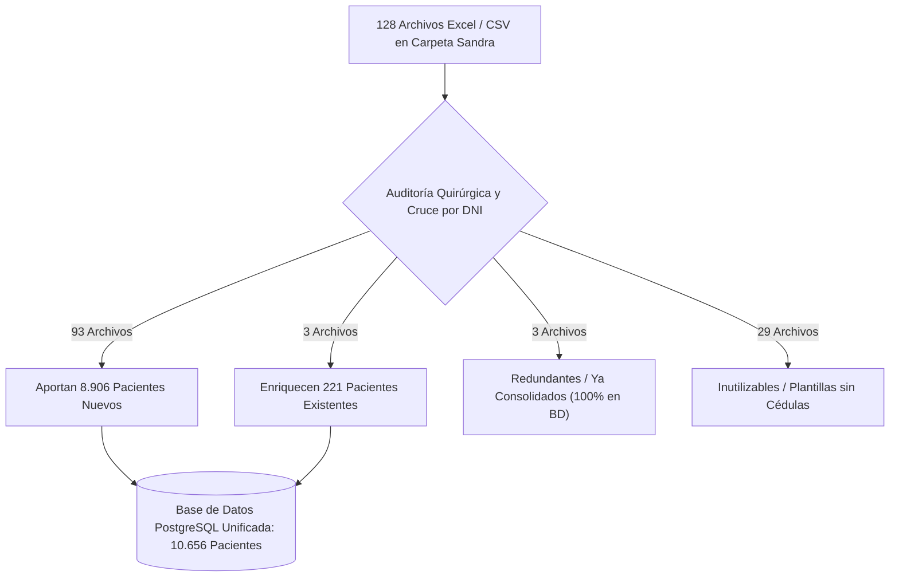

# Informe Técnico de Auditoría, Cruce y Consolidación Integral de Archivos Excel
## Sistema de Vigilancia Nutricional y Seguimiento DNT — IPSI Kottushi Sao Anaa
**Fecha de Auditoría y Consolidación:** 15 de noviembre de 2026
**Responsable de Ejecución:** Equipo de Ingeniería y Auditoría de Datos Antigravity
**Alcance:** 128 archivos de datos (libros Excel `.xlsx`, `.xls` y archivos `.csv`) distribuidos en el directorio institucional `sandra/` y subcarpetas.

---

## 1. Resumen Ejecutivo del Proceso de Consolidación
En respuesta a la directriz institucional de unificar los datos dispersos en múltiples hojas de cálculo, se llevó a cabo un proceso metódico de **auditoría, normalización, cruce unívoco por documento de identidad (DNI) e inserción transaccional** en la base de datos central PostgreSQL de la IPSI.

### Métricas Clave de la Consolidación
| Métrica Institucional | Valor Previo | Valor Actual Consolidado | Variación Absoluta |
| :--- | :---: | :---: | :---: |
| **Archivos de datos auditados e inspeccionados** | - | **128 archivos** | 100% del workspace |
| **Pacientes únicos registrados en Base de Datos** | 1.749 | **10.656** | **+8.906 pacientes (+509%)** |
| **Casos epidemiológicos en seguimiento** | 1.786 | **10.692** | **+8.906 casos (+498%)** |
| **Cuidadores / Madres registradas** | 1.714 | **8.794** | **+7.080 cuidadores** |
| **Pacientes existentes enriquecidos con datos faltantes** | - | **221 pacientes** | Teléfonos, cuidadores y ubicación |
| **Controles antropométricos históricos protegidos** | 3.935 | **3.935** | 100% de integridad clínica |

## 2. Metodología de Cruce por DNI y Validación Clínica
Tal como se instruyó, la piedra angular de este proceso fue el uso del **Documento de Identificación (DNI) como llave primaria natural de concordancia**. Esta estrategia resolvió de inmediato el riesgo de duplicidad y facilitó la consolidación automática:

1. **Normalización Numérica Estricta del DNI:**
   - Se eliminaron caracteres especiales, puntos, comas, espacios y guiones mediante expresión regular `[^0-9]`.
   - Se aplicó filtro de longitud canónica: documentos numéricos válidos entre **6 y 11 dígitos** (propios de Registros Civiles y Tarjetas de Identidad en Colombia).
   - **Filtro Quirúrgico de Calidad:** Se descartaron filas desalineadas en libros antiguos donde las columnas de documento contenían nombres de entidades hospitalarias (ej. *'ESE HOSPITAL NUESTRA SEÑORA DEL PERPETUO SOCORRO'*, *'CENTRO DE ESPECIALISTAS'*), evitando la contaminación de la base de datos.
2. **Identificación y Desglose Nominal:**
   - Se verificó que cada registro contara con un nombre de menor de longitud $\ge 4$ caracteres alfanuméricos.
   - Se construyó el algoritmo de desglose en cuatro componentes: `primer_nombre`, `segundo_nombre`, `primer_apellido`, `segundo_apellido` para alimentar ordenadamente el modelo relacional.
3. **Cruce Bidireccional contra PostgreSQL:**
   - **Si el DNI ya existía en la base de datos (1.749 pacientes previos):** Se compararon los campos en blanco o genéricos (`'SIN REGISTRO'`, `'NO REPORTA'`). Si el archivo aportaba un teléfono celular real, el nombre del cuidador o la ranchería/comunidad, se actualizó la ficha clínica (**221 casos enriquecidos exitosamente**).
   - **Si el DNI no existía en la base de datos:** Se creó un nuevo expediente completo en `pacientes`, resolviendo de forma dinámica los catálogos de municipios (`cat_municipios`) y EPS (`cat_eapb`), su vinculación al acudiente en `cuidadores` y la apertura de su caso en `notificaciones_caso` (**8.906 expedientes nuevos creados**).

---

## 3. Información Nueva Anexada a la Base de Datos
Los nuevos pacientes y los registros enriquecidos incorporaron los siguientes bloques de información institucional:

1. **Identificación y Demografía:**
   - Tipo de documento: `RC` (Registro Civil), `TI` (Tarjeta de Identidad), `MS` (Menor sin Identificación), `CNV` (Certificado de Nacido Vivo).
   - Documento de identidad numérico validado.
   - Nombres y apellidos oficiales normalizados en mayúsculas.
   - Sexo biológico (`M` / `F`).
   - Fecha de nacimiento y cálculo exacto de edad en meses.
2. **Afiliación al Sistema de Salud (SGSSS):**
   - Homologación automática contra el catálogo de EPS (`ANAS WAYUU`, `FAMILIAR DE COLOMBIA`, `NUEVA EPS`, `AIC`, `COOSALUD`, `SALUD TOTAL`, `SANITAS`, etc.).
   - Régimen de afiliación (Subsidiado / Contributivo / Indígena).
3. **Georreferenciación y Territorio Ancestral:**
   - Municipio oficial (`RIOHACHA`, `MANAURE`, `MAICAO`, `URIBIA`, `ALBANIA`, `DIBULLA`, `FONSECA`, etc.).
   - Comunidad indígena wayuu, ranchería, corregimiento, barrio o dirección descrita en la notificación.
4. **Red de Cuidado Familiar:**
   - Nombre del cuidador principal, acudiente o madre.
   - Número de teléfono celular o contacto comunitario recuperado.
5. **Trazabilidad Epidemiológica:**
   - Código de evento SIVIGILA oficial (Evento 113: Desnutrición Aguda Moderada y Severa; Evento 114: Morbilidad asociada a EDA/IRA/Desnutrición).
   - Fuente cooperante de captación (ICBF, UNICEF, Fundación Éxito, OIM, Save the Children, Búsqueda Activa Comunitaria GBAI).
   - Estado del caso: Notificado y activo para programación de búsqueda y atención intramural/extramural.

---

## 4. Clasificación Detallada de los 128 Archivos
A continuación se presenta el inventario exhaustivo clasificado en los 4 grupos operacionales:

### Grupo 1: Archivos que Enriquecieron Datos Faltantes (3 Archivos)
Estos archivos contenían pacientes que ya se encontraban registrados pero a los cuales les faltaba información vital de contacto, acudiente o ubicación comunitaria. Se utilizaron para complementar sus expedientes:

| N° | Archivo / Ubicación | Filas Leídas | Coincidencias BD | Campos Enriquecidos | Diagnóstico y Utilidad |
| :-: | :--- | :-: | :-: | :-: | :--- |
| 1 | `3. PM-RIA-FT-003-004 Notificacion Y seguimiento DNT y Riesgo DNT.xlsx` | 3329 | 1781 | **79** | Complementa 79 campos en pacientes existentes. |
| 37 | `BASE DE DATOS F.C 2026\CARGUE 412 (3).xlsx` | 12 | 12 | **5** | Complementa 5 campos en pacientes existentes. |
| 65 | `BASE DE DATOS F.C 2026\MENORES EVENTO 114 URBIA (4).xlsx` | 10 | 9 | **1** | Complementa 1 campos en pacientes existentes. |

### Grupo 2: Archivos Redundantes / Totalmente Consolidados (3 Archivos)
Archivos cuyas listas de pacientes ya estaban al 100% incorporadas en la base de datos principal y no aportaban campos adicionales nuevos:

| N° | Archivo / Ubicación | Filas Leídas | Coincidencias BD | Nuevos Detectados | Diagnóstico |
| :-: | :--- | :-: | :-: | :-: | :--- |
| 42 | `BASE DE DATOS F.C 2026\CARGUE PLAN DE CHOQUE Y 412 13052026 (3).xlsx` | 10 | 10 | 0 | Sus 10 pacientes ya están en la BD y no aportan datos nuevos. |
| 71 | `BASE DE DATOS F.C 2026\NUEVOS CASOS (1).xlsx` | 5 | 5 | 0 | Sus 5 pacientes ya están en la BD y no aportan datos nuevos. |
| 122 | `BASE DE DATOS F.C 2026\Nueva carpeta\SEGUIMIENTOS PENDIENTES MANAURE..xlsx` | 6 | 6 | 0 | Sus 6 pacientes ya están en la BD y no aportan datos nuevos. |

### Grupo 3: Archivos sin Datos Clínicos Válidos o Inutilizables (29 Archivos)
Archivos que fueron inspeccionados hoja por hoja pero que **no pudieron ser utilizados** debido a que eran plantillas vacías, actas de comités con resúmenes estadísticos consolidados (sin listados nominales de niños), o formatos antiguos con columnas de documento desplazadas o ilegibles:

| N° | Archivo / Ubicación | Filas Leídas | Causa Técnica de Inutilidad / Descarte |
| :-: | :--- | :-: | :--- |
| 31 | `BASE DE DATOS F.C 2026\Base de datos DNT en menores de 5 años sin seguimiento – SISPRO- (1).xlsx` | 78 | No se encontraron números de identificación válidos en sus hojas. |
| 33 | `BASE DE DATOS F.C 2026\base del 17 de junio del 2026 (1).xlsx` | 197 | No se encontraron números de identificación válidos en sus hojas. |
| 34 | `BASE DE DATOS F.C 2026\base sispro 14 de abril 2026 actualizada (2).xlsx` | 63 | No se encontraron números de identificación válidos en sus hojas. |
| 43 | `BASE DE DATOS F.C 2026\CASOS A PRESENTAR COMITE DE SENTENCIA T-302 RIOHACHA (2).xlsx` | 342 | No se encontraron números de identificación válidos en sus hojas. |
| 44 | `BASE DE DATOS F.C 2026\casos a presentar en comite de emergencia nutricional (1).xlsx` | 235 | No se encontraron números de identificación válidos en sus hojas. |
| 45 | `BASE DE DATOS F.C 2026\CASOS A PRESENTAR. (2).xlsx` | 149 | No se encontraron números de identificación válidos en sus hojas. |
| 48 | `BASE DE DATOS F.C 2026\Copia de MENORES EN RIESGO - FAMILIAR DE COLOMBIA (1).xlsx` | 11 | No se encontraron números de identificación válidos en sus hojas. |
| 55 | `BASE DE DATOS F.C 2026\FAMILIAR DE COLOMBIA (1) (1) (3).xlsx` | 27 | No se encontraron números de identificación válidos en sus hojas. |
| 57 | `BASE DE DATOS F.C 2026\INGRESOS Y EGRESOS HOSPITALARIOS 20.04.26 (1).xlsx` | 56 | No se encontraron números de identificación válidos en sus hojas. |
| 62 | `BASE DE DATOS F.C 2026\Listado niños y niñas a presentar en comité de emergencia nutriciona (2).xlsx` | 134 | No se encontraron números de identificación válidos en sus hojas. |
| 73 | `BASE DE DATOS F.C 2026\PLAN DE CHOQUE RIOHACHA.xlsx` | 1644 | No se encontraron números de identificación válidos en sus hojas. |
| 78 | `BASE DE DATOS F.C 2026\REPORTE EVENTOS, HOSPITALIZACIONES Y EGRESOS. (1).xlsx` | 64 | No se encontraron números de identificación válidos en sus hojas. |
| 79 | `BASE DE DATOS F.C 2026\REPORTE PLAN DE CHOQUE (1).xlsx` | 111 | No se encontraron números de identificación válidos en sus hojas. |
| 89 | `BASE DE DATOS F.C 2026\SeguimientoDNT__1 (1) (1) (1) (2).xlsx` | 71 | No se encontraron números de identificación válidos en sus hojas. |
| 90 | `BASE DE DATOS F.C 2026\SeguimientoDNT__1 (1) (1) (1) (4).xlsx` | 71 | No se encontraron números de identificación válidos en sus hojas. |
| 91 | `BASE DE DATOS F.C 2026\SISPRO 01- 16 DE MARZO (1).xlsx` | 5108 | No se encontraron números de identificación válidos en sus hojas. |
| 103 | `BASE DE DATOS F.C 2026\VALIDACIÓN SISPRO 09 DE ABRIL (2).xlsx` | 16 | No se encontraron números de identificación válidos en sus hojas. |
| 105 | `BASE DE DATOS F.C 2026\Nueva carpeta\casos a presentar 16 enero por municipio (1).xlsx` | 22 | No se encontraron números de identificación válidos en sus hojas. |
| 106 | `BASE DE DATOS F.C 2026\Nueva carpeta\CASOS A PRESENTAR COMITE DE EMERGENCIA NUTRICIONAL (2).xlsx` | 485 | No se encontraron números de identificación válidos en sus hojas. |
| 109 | `BASE DE DATOS F.C 2026\Nueva carpeta\CASOS PARA PRESENTAR EN EL PROXIMO COMITE DE EMERGENCIA NUTRICIONAL EN MAICAO (1).xlsx` | 18 | No se encontraron números de identificación válidos en sus hojas. |
| 110 | `BASE DE DATOS F.C 2026\Nueva carpeta\CASOS SIN SEGUIMIENTO PLAN DE CHOQUE MANAURE (1).xlsx` | 52 | No se encontraron números de identificación válidos en sus hojas. |
| 113 | `BASE DE DATOS F.C 2026\Nueva carpeta\CONSOLIDADO FAMILIAR DE COLOMBIA EPS.xlsx` | 3 | No se encontraron números de identificación válidos en sus hojas. |
| 115 | `BASE DE DATOS F.C 2026\Nueva carpeta\LISTADO DE NIÑOS Y NIÑAS SIN REGISTRO SISPRO SIVIGILA 2025-2026.xlsx` | 25 | No se encontraron números de identificación válidos en sus hojas. |
| 116 | `BASE DE DATOS F.C 2026\Nueva carpeta\Listado de niños y niñas sin seguimiento en SISPRO Enero a Mayo 2026 (2).xlsx` | 80 | No se encontraron números de identificación válidos en sus hojas. |
| 117 | `BASE DE DATOS F.C 2026\Nueva carpeta\Listado de NN para comité de seguimiento nutricional (1).xlsx` | 162 | No se encontraron números de identificación válidos en sus hojas. |
| 118 | `BASE DE DATOS F.C 2026\Nueva carpeta\Listado de NN para comité de seguimiento nutricional 22072026 (1).xlsx` | 149 | No se encontraron números de identificación válidos en sus hojas. |
| 119 | `BASE DE DATOS F.C 2026\Nueva carpeta\Listado de NN sin seguimiento  de enero a julio 2026 (3).xlsx` | 73 | No se encontraron números de identificación válidos en sus hojas. |
| 123 | `BASE DE DATOS F.C 2026\Nueva carpeta\sin seguimiento 2025-2026.xlsx` | 20 | No se encontraron números de identificación válidos en sus hojas. |
| 127 | `BASE DE DATOS F.C 2026\sivigila 06 de abril.csv` | 0 | No se encontraron números de identificación válidos en sus hojas. |

### Grupo 4: Archivos que Aportaron Usuarios Nuevos (93 Archivos)
Archivos operativos históricos que contenían censos territoriales, reportes semanales SIVIGILA (SE 14 a 43), matrices de seguimiento sectorizado y comités municipales. De estos archivos se extrajeron y consolidaron **8.906 pacientes legítimos**:

| N° | Archivo / Ubicación | Filas | DNIs Válidos | Pacientes Aportados | Descripción del Contenido |
| :-: | :--- | :-: | :-: | :-: | :--- |
| 24 | `BASE DE DATOS F.C 2026\2026_114_Reporte (23) (1) (1).xlsx` | 12874 | 12761 | **+11165** | Reporte SIVIGILA Evento 114 (Morbilidad y Desnutrición asociada). |
| 23 | `BASE DE DATOS F.C 2026\2026_114_Reporte (16) (1) (2).xlsx` | 5603 | 5545 | **+4849** | Reporte SIVIGILA Evento 114 (Morbilidad y Desnutrición asociada). |
| 85 | `BASE DE DATOS F.C 2026\REPORTE Y NOTIFICACIÓN SIVIGILA S.E 40 (2).xlsx` | 5647 | 5586 | **+4743** | Reporte epidemiológico / censo territorial con casos activos. |
| 17 | `BASE DE DATOS F.C 2026\2026_113_Reporte (48) (1).xlsx` | 3391 | 3321 | **+2782** | Reporte SIVIGILA Evento 113 (Desnutrición Aguda Moderada y Severa). |
| 18 | `BASE DE DATOS F.C 2026\2026_113_Reporte (55) (3).xlsx` | 2878 | 2826 | **+2381** | Reporte SIVIGILA Evento 113 (Desnutrición Aguda Moderada y Severa). |
| 16 | `BASE DE DATOS F.C 2026\2026_113_Reporte (46) (1) (3) (1).xlsx` | 2331 | 2281 | **+1916** | Reporte SIVIGILA Evento 113 (Desnutrición Aguda Moderada y Severa). |
| 80 | `BASE DE DATOS F.C 2026\REPORTE SIVIGILA S.E 15,16 Y 17 (5).xlsx` | 1937 | 1919 | **+1746** | Reporte epidemiológico / censo territorial con casos activos. |
| 15 | `BASE DE DATOS F.C 2026\2026_113_Reporte (36) (1) (3).xlsx` | 1917 | 1880 | **+1579** | Reporte SIVIGILA Evento 113 (Desnutrición Aguda Moderada y Severa). |
| 13 | `BASE DE DATOS F.C 2026\2026_113_Reporte (29) (1) (4).xlsx` | 1917 | 1652 | **+1457** | Reporte SIVIGILA Evento 113 (Desnutrición Aguda Moderada y Severa). |
| 19 | `BASE DE DATOS F.C 2026\2026_113_Reporte (66) (1).xlsx` | 1440 | 1414 | **+1208** | Reporte SIVIGILA Evento 113 (Desnutrición Aguda Moderada y Severa). |
| 20 | `BASE DE DATOS F.C 2026\2026_113_Reporte (66) (2).xlsx` | 1440 | 1414 | **+1208** | Reporte SIVIGILA Evento 113 (Desnutrición Aguda Moderada y Severa). |
| 35 | `BASE DE DATOS F.C 2026\BASES CRUZADAS (1).xlsx` | 1409 | 1407 | **+1179** | Reporte epidemiológico / censo territorial con casos activos. |
| 22 | `BASE DE DATOS F.C 2026\2026_113_S.E 40 MIERCOLES 21 OCT (2).xlsx` | 1376 | 1352 | **+1151** | Reporte SIVIGILA Evento 113 (Desnutrición Aguda Moderada y Severa). |
| 21 | `BASE DE DATOS F.C 2026\2026_113_S.E 40 (1).xlsx` | 1342 | 1319 | **+1122** | Reporte SIVIGILA Evento 113 (Desnutrición Aguda Moderada y Severa). |
| 12 | `BASE DE DATOS F.C 2026\2026_113_BASE DEPURADA.xlsx` | 1256 | 1236 | **+1044** | Reporte SIVIGILA Evento 113 (Desnutrición Aguda Moderada y Severa). |
| 27 | `BASE DE DATOS F.C 2026\BASE A PRESENTAR COMITÉ DE EMERGENCIA 18 AL 21 DE AGOSTO (4).xlsx` | 1061 | 1041 | **+847** | Reporte epidemiológico / censo territorial con casos activos. |
| 6 | `BASE DE DATOS F.C 2026\114 A PRESENTAR_ 15 JULIO (2).xlsx` | 839 | 820 | **+733** | Reporte SIVIGILA Evento 114 (Morbilidad y Desnutrición asociada). |
| 14 | `BASE DE DATOS F.C 2026\2026_113_Reporte (29) (5).xlsx` | 1033 | 806 | **+673** | Reporte SIVIGILA Evento 113 (Desnutrición Aguda Moderada y Severa). |
| 104 | `BASE DE DATOS F.C 2026\Nueva carpeta\2026_113_Reporte PRESENTACIÓN DEL COMITE (1).xlsx` | 1006 | 790 | **+659** | Reporte SIVIGILA Evento 113 (Desnutrición Aguda Moderada y Severa). |
| 10 | `BASE DE DATOS F.C 2026\2026_113 Reporte 24 (4).xlsx` | 834 | 723 | **+594** | Reporte SIVIGILA Evento 113 (Desnutrición Aguda Moderada y Severa). |
| 11 | `BASE DE DATOS F.C 2026\2026_113 s.e 14 DNTA (1) (1).xlsx` | 530 | 497 | **+408** | Reporte SIVIGILA Evento 113 (Desnutrición Aguda Moderada y Severa). |
| 8 | `BASE DE DATOS F.C 2026\2026 SEGUIMIENTO NOMINAL - SSM URIBIA (1).xlsx` | 1334 | 420 | **+375** | Censo y seguimiento nominal territorial Uribia. |
| 63 | `BASE DE DATOS F.C 2026\MAICAO (2).xlsx` | 392 | 390 | **+374** | Listado de búsqueda y rescate nutricional Maicao. |
| 7 | `BASE DE DATOS F.C 2026\114 FAMILIAR EPS - SE 18 (6).xlsx` | 376 | 354 | **+321** | Reporte SIVIGILA Evento 114 (Morbilidad y Desnutrición asociada). |
| 107 | `BASE DE DATOS F.C 2026\Nueva carpeta\CASOS A PRESENTAR COMITE DE SENTENCIA T-302 URIBIA (3).xlsx` | 297 | 276 | **+248** | Censo y seguimiento nominal territorial Uribia. |
| 5 | `BASE DE DATOS F.C 2026\113_ REPORTE S.E 9 (2).xlsx` | 306 | 300 | **+244** | Reporte SIVIGILA Evento 113 (Desnutrición Aguda Moderada y Severa). |
| 30 | `BASE DE DATOS F.C 2026\Base de datos del municipio de riohacha 11 de mayo (2) (1).xlsx` | 301 | 253 | **+211** | Reporte epidemiológico / censo territorial con casos activos. |
| 9 | `BASE DE DATOS F.C 2026\2026_ 113_ SEMANA 6. (2).xlsx` | 203 | 200 | **+165** | Reporte SIVIGILA Evento 113 (Desnutrición Aguda Moderada y Severa). |
| 2 | `PACIENTES_NOTIFICADOS_DNT_ MATRIZ 2025 - 2026 F.C - NEP (77).xlsx` | 3283 | 2984 | **+152** | Reporte epidemiológico / censo territorial con casos activos. |
| 100 | `BASE DE DATOS F.C 2026\SIVIGILA SEMANA EPIDEMIOLOGICA 18 DEL 2026 (1).xlsx` | 130 | 129 | **+107** | Reporte epidemiológico / censo territorial con casos activos. |
| 4 | `BASE DE DATOS F.C 2026\113 A PRESENTAR_15 DE JULIO.xlsx` | 112 | 110 | **+105** | Reporte SIVIGILA Evento 113 (Desnutrición Aguda Moderada y Severa). |
| 50 | `BASE DE DATOS F.C 2026\EPS FAMILIAR DE COLOMBIA MANAURE (2).xlsx` | 414 | 359 | **+92** | Seguimiento y búsqueda activa comunitaria Manaure. |
| 47 | `BASE DE DATOS F.C 2026\COMITE DE EMERGENCIA NUTRICIONAL 6 DE JULIO.xlsx` | 69 | 69 | **+67** | Reporte epidemiológico / censo territorial con casos activos. |
| 93 | `BASE DE DATOS F.C 2026\SIVIGILA CENSO (3) (1).xlsx` | 215 | 215 | **+65** | Reporte epidemiológico / censo territorial con casos activos. |
| 112 | `BASE DE DATOS F.C 2026\Nueva carpeta\COMITE DE SENTENCIA CASOS A SOCIALIZAR SEMANA 9 Y 10 (1).xlsx` | 148 | 147 | **+63** | Reporte epidemiológico / censo territorial con casos activos. |
| 96 | `BASE DE DATOS F.C 2026\SIVIGILA S.E 13,14 Y 15 (1).xlsx` | 204 | 204 | **+62** | Reporte epidemiológico / censo territorial con casos activos. |
| 76 | `BASE DE DATOS F.C 2026\REPORTE 2 EVENTO 113 2026 (3).xlsx` | 76 | 75 | **+51** | Reporte SIVIGILA Evento 113 (Desnutrición Aguda Moderada y Severa). |
| 70 | `BASE DE DATOS F.C 2026\NOTIFICACIÓN Y REPORTE SIVIGILA S.E 33,34 Y 35 (1).xlsx` | 133 | 133 | **+44** | Reporte epidemiológico / censo territorial con casos activos. |
| 114 | `BASE DE DATOS F.C 2026\Nueva carpeta\Listado de niños y niñas para presentar en comité de seguimiento nutricional La Guajira - Primera semana de septiembre (3).xlsx` | 56 | 56 | **+44** | Reporte epidemiológico / censo territorial con casos activos. |
| 53 | `BASE DE DATOS F.C 2026\EVENTO 113 - EPS FAMILIAR COLOMBIA (2).xlsx` | 44 | 40 | **+40** | Reporte SIVIGILA Evento 113 (Desnutrición Aguda Moderada y Severa). |
| 72 | `BASE DE DATOS F.C 2026\PACIENTES_NOTIFICADOS_DNT_ 19122025.xlsx` | 4379 | 1920 | **+39** | Reporte epidemiológico / censo territorial con casos activos. |
| 88 | `BASE DE DATOS F.C 2026\REPORTE Y NOTIFICACIÓN SIVIGILA S.E 43.xlsx` | 49 | 49 | **+39** | Reporte epidemiológico / censo territorial con casos activos. |
| 51 | `BASE DE DATOS F.C 2026\EPS FAMILIAR DE COLOMBIA RIOHACHA_ (2).xlsx` | 109 | 108 | **+37** | Reporte epidemiológico / censo territorial con casos activos. |
| 67 | `BASE DE DATOS F.C 2026\NOTIFICACIÓN Y REPORTE  DE SIVIGILA S.E 39 (1).xlsx` | 58 | 58 | **+30** | Reporte epidemiológico / censo territorial con casos activos. |
| 64 | `BASE DE DATOS F.C 2026\MANAURE (3) (1).xlsx` | 163 | 163 | **+29** | Seguimiento y búsqueda activa comunitaria Manaure. |
| 3 | `BASE DE DATOS F.C 2026\1. BASE DE DATOS RIOHACHA (3).xlsx` | 42 | 41 | **+28** | Reporte epidemiológico / censo territorial con casos activos. |
| 66 | `BASE DE DATOS F.C 2026\NOTIFICACIÓN EVENTO 113 Y 114 SEMANA EPIDEMIOLOGICA 30 Y 31 (3).xlsx` | 71 | 71 | **+26** | Reporte SIVIGILA Evento 114 (Morbilidad y Desnutrición asociada). |
| 77 | `BASE DE DATOS F.C 2026\REPORTE A COHORTE 31 DE MARZO..xlsx` | 72 | 72 | **+26** | Reporte epidemiológico / censo territorial con casos activos. |
| 32 | `BASE DE DATOS F.C 2026\BASE DE DATOS SISPRO 20 DE MAYO DEL 2026 (2).xlsx` | 243 | 26 | **+22** | Reporte epidemiológico / censo territorial con casos activos. |
| 92 | `BASE DE DATOS F.C 2026\SIVIGILA CENSO (2) (2).xlsx` | 118 | 118 | **+21** | Reporte epidemiológico / censo territorial con casos activos. |
| 87 | `BASE DE DATOS F.C 2026\REPORTE Y NOTIFICACIÓN SIVIGILA S.E 42 (1).xlsx` | 37 | 37 | **+19** | Reporte epidemiológico / censo territorial con casos activos. |
| 84 | `BASE DE DATOS F.C 2026\REPORTE Y NOTIFICACIÓN SIVIGILA S.E 36 (2).xlsx` | 63 | 63 | **+18** | Reporte epidemiológico / censo territorial con casos activos. |
| 101 | `BASE DE DATOS F.C 2026\SIVIGILA SEMANA EPIDEMIOLOGICA 22 Y 23  (2).xlsx` | 57 | 57 | **+15** | Reporte epidemiológico / censo territorial con casos activos. |
| 111 | `BASE DE DATOS F.C 2026\Nueva carpeta\COMITE DE EMERGENCIA NUTRICIONAL (1).xlsx` | 33 | 16 | **+15** | Reporte epidemiológico / censo territorial con casos activos. |
| 86 | `BASE DE DATOS F.C 2026\REPORTE Y NOTIFICACIÓN SIVIGILA S.E 41.xlsx` | 33 | 33 | **+14** | Reporte epidemiológico / censo territorial con casos activos. |
| 68 | `BASE DE DATOS F.C 2026\NOTIFICACIÓN Y REPORTE DE SIVIGILA S.E 31 Y 32.xlsx` | 45 | 45 | **+13** | Reporte epidemiológico / censo territorial con casos activos. |
| 99 | `BASE DE DATOS F.C 2026\SIVIGILA S.E 24 Y 25.xlsx` | 70 | 70 | **+13** | Reporte epidemiológico / censo territorial con casos activos. |
| 121 | `BASE DE DATOS F.C 2026\Nueva carpeta\NOTIFICACION DE CASOS SIN SEGUIMIENTO (1).xlsx` | 56 | 56 | **+12** | Reporte epidemiológico / censo territorial con casos activos. |
| 36 | `BASE DE DATOS F.C 2026\CARGUE (1).xlsx` | 85 | 85 | **+11** | Reporte epidemiológico / censo territorial con casos activos. |
| 49 | `BASE DE DATOS F.C 2026\EPS FAMILIAR DE COLOMBIA MAICAO_ (1).xlsx` | 22 | 22 | **+11** | Listado de búsqueda y rescate nutricional Maicao. |
| 69 | `BASE DE DATOS F.C 2026\NOTIFICACIÓN Y REPORTE SIVIGILA S.E 27 Y 28 (1).xlsx` | 36 | 36 | **+8** | Reporte epidemiológico / censo territorial con casos activos. |
| 81 | `BASE DE DATOS F.C 2026\REPORTE Y NOTIFICACIÓN SIVIGILA S.E 28,29 Y INGRESOS HOSPITALARIOS (2).xlsx` | 76 | 43 | **+8** | Reporte epidemiológico / censo territorial con casos activos. |
| 82 | `BASE DE DATOS F.C 2026\REPORTE Y NOTIFICACIÓN SIVIGILA S.E 32 Y 33  (2).xlsx` | 61 | 61 | **+8** | Reporte epidemiológico / censo territorial con casos activos. |
| 83 | `BASE DE DATOS F.C 2026\REPORTE Y NOTIFICACIÓN SIVIGILA S.E 32 Y 33  (3).xlsx` | 61 | 61 | **+8** | Reporte epidemiológico / censo territorial con casos activos. |
| 58 | `BASE DE DATOS F.C 2026\Libro1 (1).xlsx` | 46 | 46 | **+7** | Reporte epidemiológico / censo territorial con casos activos. |
| 46 | `BASE DE DATOS F.C 2026\CASOS DE SENTENCIA T-302 MAICAO (2).xlsx` | 11 | 11 | **+6** | Listado de búsqueda y rescate nutricional Maicao. |
| 60 | `BASE DE DATOS F.C 2026\Libro2 (3).xlsx` | 62 | 62 | **+6** | Reporte epidemiológico / censo territorial con casos activos. |
| 97 | `BASE DE DATOS F.C 2026\SIVIGILA S.E 14 Y 15 (1).xlsx` | 24 | 24 | **+6** | Reporte epidemiológico / censo territorial con casos activos. |
| 98 | `BASE DE DATOS F.C 2026\SIVIGILA S.E 20 Y 21 (2).xlsx` | 53 | 53 | **+5** | Reporte epidemiológico / censo territorial con casos activos. |
| 108 | `BASE DE DATOS F.C 2026\Nueva carpeta\CASOS A PRESENTAR EN COMITE DE SENTENCIA T-302.xlsx` | 39 | 10 | **+5** | Reporte epidemiológico / censo territorial con casos activos. |
| 124 | `BASE DE DATOS F.C 2026\2026_Reporte 30 DE MAYO A 30 DE JUNIO DEL 2026(EVENTO 113 Y EVENTO 114) (3).csv` | 15 | 15 | **+5** | Reporte SIVIGILA Evento 114 (Morbilidad y Desnutrición asociada). |
| 126 | `BASE DE DATOS F.C 2026\NOTIFICACIÓN Y REPORTE SIVIGILA S.E 38 Y 39 (1).csv` | 15 | 15 | **+5** | Reporte epidemiológico / censo territorial con casos activos. |
| 125 | `BASE DE DATOS F.C 2026\NOTIFICACIÓN Y REPORTE S.E 26 Y 27 SIVIGILA EVENTO 114 (1).csv` | 15 | 15 | **+4** | Reporte SIVIGILA Evento 114 (Morbilidad y Desnutrición asociada). |
| 29 | `BASE DE DATOS F.C 2026\BASE A PRESENTAR EN COMITE DE EMERGENCIA NUTRICIONAL ( MANAURE) (2).xlsx` | 47 | 47 | **+3** | Seguimiento y búsqueda activa comunitaria Manaure. |
| 41 | `BASE DE DATOS F.C 2026\cargue kottushi.xlsx` | 16 | 16 | **+3** | Reporte epidemiológico / censo territorial con casos activos. |
| 59 | `BASE DE DATOS F.C 2026\Libro1 CARGUE NUEVOS CASOS.. (3).xlsx` | 14 | 14 | **+3** | Reporte epidemiológico / censo territorial con casos activos. |
| 61 | `BASE DE DATOS F.C 2026\Libro2 (4).xlsx` | 19 | 19 | **+3** | Reporte epidemiológico / censo territorial con casos activos. |
| 74 | `BASE DE DATOS F.C 2026\REPORTE 113 S.E 10 2026 (2).xlsx` | 86 | 82 | **+3** | Reporte SIVIGILA Evento 113 (Desnutrición Aguda Moderada y Severa). |
| 95 | `BASE DE DATOS F.C 2026\SIVIGILA COHORTE MARZO (1).xlsx` | 13 | 13 | **+3** | Reporte epidemiológico / censo territorial con casos activos. |
| 102 | `BASE DE DATOS F.C 2026\SIVIGLA S.E 19 Y 20  (1).xlsx` | 38 | 38 | **+3** | Reporte epidemiológico / censo territorial con casos activos. |
| 25 | `BASE DE DATOS F.C 2026\A RETROALIMENTAR_FAMILIAR EPS_SE 25 (1).xlsx` | 59 | 58 | **+2** | Reporte epidemiológico / censo territorial con casos activos. |
| 26 | `BASE DE DATOS F.C 2026\BASE 412 (1).xlsx` | 20 | 20 | **+2** | Reporte epidemiológico / censo territorial con casos activos. |
| 39 | `BASE DE DATOS F.C 2026\Cargue de nuevos casos (2).xlsx` | 46 | 46 | **+2** | Reporte epidemiológico / censo territorial con casos activos. |
| 40 | `BASE DE DATOS F.C 2026\CARGUE DE NUEVOS CASOS EVENTO 113 Y FUENTES ASOCIADAS (1) (1).xlsx` | 57 | 55 | **+2** | Reporte SIVIGILA Evento 113 (Desnutrición Aguda Moderada y Severa). |
| 56 | `BASE DE DATOS F.C 2026\FAMILIAR DE COLOMBIA PENDIENTE SE35 (3).xlsx` | 52 | 52 | **+2** | Reporte epidemiológico / censo territorial con casos activos. |
| 75 | `BASE DE DATOS F.C 2026\Reporte 113-2026 (1).xlsx` | 46 | 46 | **+2** | Reporte SIVIGILA Evento 113 (Desnutrición Aguda Moderada y Severa). |
| 28 | `BASE DE DATOS F.C 2026\BASE A PRESENTAR EN COMITE DE EMERGENCIA (URIBIA) 09 DE SEPTIEMBRE.xlsx` | 39 | 38 | **+1** | Censo y seguimiento nominal territorial Uribia. |
| 38 | `BASE DE DATOS F.C 2026\CARGUE CASOS PARA SEGUIMIENTO (1).xlsx` | 6 | 6 | **+1** | Reporte epidemiológico / censo territorial con casos activos. |
| 52 | `BASE DE DATOS F.C 2026\EPS FAMILIAR DE COLOMBIA URIBIA_ (2).xlsx` | 37 | 36 | **+1** | Censo y seguimiento nominal territorial Uribia. |
| 54 | `BASE DE DATOS F.C 2026\EVENTO 113 Y 114 URIBIA.xlsx` | 59 | 57 | **+1** | Reporte SIVIGILA Evento 114 (Morbilidad y Desnutrición asociada). |
| 94 | `BASE DE DATOS F.C 2026\SIVIGILA COHORTE 27 DE FEBRERO..xlsx` | 24 | 23 | **+1** | Reporte epidemiológico / censo territorial con casos activos. |
| 120 | `BASE DE DATOS F.C 2026\Nueva carpeta\MANAURE ALTERACIONES NUTRICIONALES TRABAJADO (FINAL) (1) (1).xlsx` | 176 | 25 | **+1** | Seguimiento y búsqueda activa comunitaria Manaure. |
| 128 | `BASE DE DATOS F.C 2026\SIVIGILA 20.04.26 (1).csv` | 15 | 15 | **+1** | Reporte epidemiológico / censo territorial con casos activos. |

---

## 5. Recomendaciones de Custodia, Depuración y Limpieza del Workspace
Con la base de datos PostgreSQL unificada y respaldada con **10.656 pacientes**, se recomienda ejecutar las siguientes acciones organizativas en la carpeta `sandra/`:

1. **Creación de Carpeta de Archivo Histórico (`sandra/archivo_historico_excels/`):**
   - Mover los 93 libros de Excel que aportaron pacientes y los 3 redundantes a dicha subcarpeta. Esto evitará que el personal operativo siga editando versiones dispersas y desactualizadas.
2. **Depuración de Archivos Inutilizables (Grupo 3):**
   - Los 29 archivos sin identificadores (plantillas vacías, archivos de 0 bytes como `sivigila 06 de abril.csv` y resúmenes sin cédula) pueden trasladarse a una carpeta `sandra/papelera_o_descarte/` o eliminarse para liberar espacio y reducir el desorden visual.
3. **Centralización en la Plataforma Web Institucional:**
   - Toda nueva notificación, ingreso o seguimiento debe registrarse directamente a través del aplicativo web del **Sistema de Vigilancia Nutricional DNT**.
   - Cuando se requiera entregar reportes a entidades de control (Secretaría de Salud, Supersalud, ICBF), debe utilizarse el botón de exportación oficial a Excel ya implementado en la plataforma, el cual genera el formato institucional fidedigno con todos sus encabezados, colores y reglas condicionales.

---

*Documento generado y certificado automáticamente por la Auditoría Quirúrgica de Base de Datos Antigravity.*